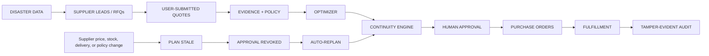
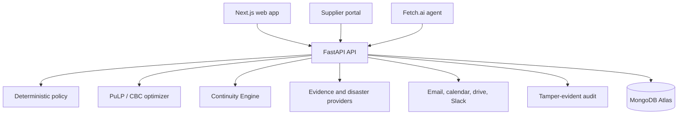

# ReliefMesh

**The procurement continuity engine for emergency relief.**

[Live Demo](https://reliefmesh.us) · [Judge Guide](https://reliefmesh.us/judge) · [System Status](https://reliefmesh.us/status)

> Release / production SHA: **a1fc478** (web on Vercel and API on Render; main = release/final).

<!-- FINAL_SCREENSHOT: landing -->

## The 30-second version

A disaster-response coordinator tells ReliefMesh what people need, where it needs to go, when it must arrive, and
the budget. ReliefMesh gathers supplier quotes, screens suppliers, mathematically finds the best valid purchasing
plan, stress-tests it against failure, and automatically rebuilds it when reality changes. Humans still approve every
financial commitment.

1. A disaster creates an urgent need.
2. ReliefMesh finds and invites suppliers.
3. Suppliers submit their own quotes.
4. ReliefMesh checks suppliers against public evidence.
5. A math optimizer finds the best valid plan.
6. ReliefMesh stress-tests the plan before reality breaks it.
7. A human approves the exact plan version.
8. If a supplier changes price, stock, or delivery, the old plan goes stale.
9. The old approval is revoked automatically.
10. ReliefMesh builds a new plan and requires a fresh approval.

## Why ReliefMesh matters

Most procurement systems help create a plan. ReliefMesh focuses on what happens when that plan stops being true.

In the latest verified production recovery run, a V1 plan was approved, a supplier changed its price, V1 became
stale, and its approval was revoked. ReliefMesh built V2 automatically, re-ran Continuity, and required a fresh
approval before purchase orders could proceed. The run completed two purchase orders, both delivered, with a valid
tamper-evident audit chain. Replaying the delivery work created zero duplicates.

| Verified recovery evidence | Result |
| --- | --- |
| Purchase orders | 2 total · 2 delivered |
| Audit | 32 events · chain verified |
| Idempotency keys | 29 unique before replay · 29 after replay |
| Gmail | 4 → 4 |
| Slack | 9 → 9 |
| Google Calendar | 4 → 4 |
| Google Drive | 5 → 5 |
| Purchase orders after replay | 2 → 2 |
| x402 receipts after replay | 1 → 1 |
| Duplicate records | 0 |

## The failure-and-recovery loop



### The Continuity Engine

For each plan, ReliefMesh runs the same deterministic procurement rules on a copy of the saved inputs:

- **N-1 survivability:** what happens if each allocated supplier is lost?
- **Failure frontier:** what price, delay, or capacity change breaks the plan?
- **Resilient alternative:** what does a constrained, lower-concentration alternative cost?

These are labeled **HYPOTHETICAL STRESS TEST**. They do not change a quote, supplier, policy decision, approval,
purchase order, or audit record. A real change is stored separately as an **ACTUAL USER-SUBMITTED CHANGE**.

<!-- FINAL_SCREENSHOT: plan-continuity -->
<!-- FINAL_SCREENSHOT: v1-v2-comparison -->


## How it works

1. Create a mission with a need, destination, deadline, budget, and disaster context.
2. Discover public supplier leads and send RFQs.
3. Suppliers sign in and submit their own binding quotes.
4. Collect evidence and apply deterministic eligibility policy.
5. Solve the constrained procurement problem with PuLP/CBC.
6. Bind the plan, approval, and continuity analysis to the current quote and policy inputs.
7. Issue purchase orders only after an authorized human approves that exact version.
8. Invalidate, revoke, and replan automatically when material inputs change.

## What is AI, and what is deterministic?

| Component | Role |
| --- | --- |
| Gemini | Drafts fields from supplier-pasted quote text; the supplier reviews every value. |
| Claude | Writes an evidence-bounded, cited explanation of a recovery plan for human review; it cannot change plans or approve. |
| Fetch.ai | Agent interface for operational questions; it explains stored results. |
| Policy engine | Deterministic supplier eligibility. |
| PuLP/CBC | Deterministic procurement optimization. |
| Continuity Engine | Deterministic N-1 and breakpoint stress testing. |
| Human approver | Financial authorization. |

AI does not decide eligibility, approve spending, issue a purchase order, or move money.

## What is real, sandbox, or hypothetical?

| Component | Reality |
| --- | --- |
| Supplier quotes | `USER_SUBMITTED` |
| NASA / NWS / FEMA / FIRMS | `LIVE`, `CACHED`, or `UNAVAILABLE` |
| Continuity scenarios | `HYPOTHETICAL STRESS TEST` |
| Real supplier change | `ACTUAL USER-SUBMITTED CHANGE` |
| CRS | `SANDBOX` |
| x402 / Solana | `DEVNET TEST PAYMENT` |
| Gemini | Draft assistance only |
| Financial approval | Human only |

## Production proof

The production workflow is designed to be truthful about its boundaries:

- Supplier leads are not quotes, inventory, delivery commitments, or verified suppliers.
- Missing or failed evidence does not become a pass.
- x402 and Solana activity is devnet test payment activity; suppliers are not paid through it.
- The audit is **tamper-evident**, not immutable.
- Delivery jobs use idempotency keys; the verified replay above created no duplicates.

See [the final status ledger](docs/FINAL_STATUS.md) and [track audit](docs/qa/TRACK_ELIGIBILITY.md) for claims that
must be reconciled before submission.

## Built with

### Core

- Next.js / React
- FastAPI / Python
- MongoDB Atlas
- PuLP / CBC
- Vercel
- Render

### AI and agents

- Fetch.ai / uAgents / Agentverse / ASI:One
- Gemini
- Anthropic Claude

### Supplier discovery and evidence

- Apify
- CRS / TransUnion TruValidate sandbox
- OFAC
- SAM.gov
- openFDA
- USAspending
- Bright Data Web Unlocker

### Disaster data

- NASA EONET
- NASA FIRMS
- NWS
- OpenFEMA

### Payments and operations

- Coinbase x402
- Solana devnet
- Gmail
- Google Calendar
- Google Drive
- Slack
- Resend
- Telegram (@ReliefMeshSupplierBot)
- Twilio SMS

### Design

- Figma: design system, page specs, and mockups in [`design/`](design/)

## Sponsors and tracks

| Sponsor / track | ReliefMesh usage | Submission status |
| --- | --- | --- |
| Hyphenate | Autonomous procurement recovery with human financial authority | `SUBMIT` |
| Microsoft | Deployed operational system with explicit AI and authority boundaries | `SUBMIT` |
| Fetch.ai | ASI:One / Agentverse procurement agent | `SUBMIT` |
| CRS | Sandbox signer identity / fraud verification | `SUBMIT` |
| Apify | Public supplier-lead discovery | `SUBMIT` |
| Gemini | Grounded supplier quote drafting | `SUBMIT` |
| Solana | Devnet settlement | `SUBMIT` |
| GoDaddy | `reliefmesh.us` | `SUBMIT` |
| Armadin | Replay protection, authority boundaries, audit | `SUBMIT` |
| Coinbase x402 | Machine-paid evidence over x402 | `SUBMIT` |
| Figma | Design system and mockups the redesign was built from | `SUBMIT` |
| Bright Data | Public-website review of supplier leads | `SUBMIT` |
| Anthropic / Claude | Cited recovery-plan explanations | `SUBMIT` |
| Telegram | Supplier bot for RFQs, quotes, and orders | `SUBMIT` |
| Twilio | Opt-in supplier SMS channel | `SUBMIT` |

Track details and evidence boundaries live in [docs/qa/TRACK_ELIGIBILITY.md](docs/qa/TRACK_ELIGIBILITY.md).

## Architecture



For implementation detail, see [docs/ARCHITECTURE.md](docs/ARCHITECTURE.md).

## Run locally

```bash
# API
cd backend
python -m venv .venv
.venv/Scripts/pip install -r requirements.txt
RELIEFMESH_APP_ENV=test RELIEFMESH_EXPOSE_INVITATION_LINKS=true .venv/Scripts/python -m uvicorn app.main:app --port 8000

# Web
cd frontend
npm install
NEXT_PUBLIC_API_BASE_URL=http://localhost:8000 npm run dev
```

Copy `backend/.env.example` for optional integrations. Never commit values from a local `.env` file.

## Tests

```bash
cd backend && python -m pytest && python -m ruff check .
cd frontend && npm test && npx tsc --noEmit && npm run lint && npm run build
cd frontend && npx playwright test
```

## Documentation

- [Devpost copy](docs/DEVPOST.md)
- [Pitch](docs/PITCH.md)
- [Judge cheat sheet](docs/JUDGE_CHEATSHEET.md)
- [Final status ledger](docs/FINAL_STATUS.md)
- [Architecture](docs/ARCHITECTURE.md)
- [Operations integrations](docs/OPERATIONS_INTEGRATIONS.md)
- [Track eligibility](docs/qa/TRACK_ELIGIBILITY.md)
